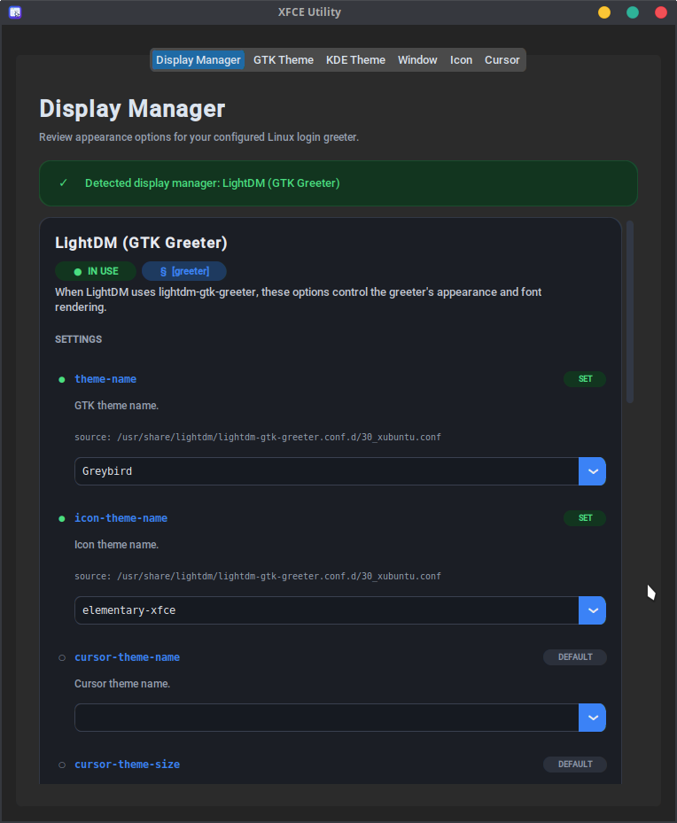

# XFCE Utility

A desktop utility for browsing and applying installed GTK, XFWM4, icon, cursor, and KDE Plasma global themes, and reviewing display-manager appearance options from a single interface. XFCE Utility is built with Python and CustomTkinter and uses the desktop's existing theme settings rather than downloading or installing theme collections.

## Application preview



[](LICENSE)


## Features

- **GTK themes:** Discover installed GTK themes, show their installation paths and GTK 2/3/4 and XFWM4 support, and apply a selected theme. Related icon, cursor, or window themes declared by the GTK theme are applied when available.
- **Window themes:** Browse and apply installed XFWM4 window-decoration themes.
- **Icon themes:** Browse installed icon themes and view a preview composed from sample icons when the theme provides them.
- **Cursor themes:** Browse installed Xcursor themes, including themes that inherit cursor assets from another theme, and display a cursor preview when an image is available.
- **KDE Plasma global themes:** Discover installed look-and-feel packages, inspect their package IDs and descriptions, and apply them to the current KDE user or configure all homes under `/home`.
- **Display manager settings:** Detect LightDM, SDDM, or GDM through the default-display-manager file or systemd service alias, review active greeter values and their source files, and edit supported settings with administrator authorization. Updates preserve other configuration content and create a backup copy. LightDM GTK greeter drop-ins follow GLib's system XDG data/config directory order; its compiled main config location uses the standard `/etc/lightdm/lightdm-gtk-greeter.conf` default.
- **All-user configuration:** Theme tabs provide an opt-in to apply settings to accounts under `/home`. Existing configuration files are backed up before they are changed.
- **Desktop settings integration:** Apply themes through XFCE settings and, when available, GNOME `gsettings` keys.
- **Theme details and feedback:** View theme names and paths, see which theme is active when it can be detected, and receive status or error messages while loading or applying settings.

KDE theme application requires KDE Plasma's `lookandfeeltool` (typically provided by `plasma-workspace`) and changes KDE configuration; it does not change XFCE themes. The KDE all-user option requires the selected theme to be installed system-wide under `/usr/share/plasma/look-and-feel` or `/usr/local/share/plasma/look-and-feel`.

## Requirements

- Linux with XFCE settings tools available (`xfconf-query`); `gsettings` is used when available.
- Python 3.10 or newer.
- Python packages listed in [`requirements.txt`](requirements.txt).
- On Ubuntu, the Tk, Cairo, Xcursor, and Polkit packages listed below. An XFCE Polkit authentication agent must be running for display-manager saves and all-user changes.
- Applying KDE Plasma global themes additionally requires `lookandfeeltool`; this is optional if you only use the XFCE theme tabs.

## Build and system-wide installation

The installer builds a wheel in a project-local virtual environment, installs it in a dedicated root-owned environment under `/opt/xfceutil`, removes group/other write permissions from that environment, and registers a system launcher and XFCE Utility icon. The app itself runs as your desktop user; Polkit authentication is requested for display-manager saves and all-user changes.

On Ubuntu, Install the runtime packages and Python build tools:

```bash
sudo apt update
sudo apt install python3 python3-venv python3-tk libcairo2 libxcursor1 xfconf libglib2.0-bin
```

The app uses the system's existing Polkit `pkexec` and authentication agent; do not install another Polkit agent for XFCE Utility.

From the project directory, run the installer as your normal desktop user:

```bash
./install.sh
```

The installer prompts for sudo when it creates or updates the system environment and force-reinstalls the local wheel, including when rebuilding the same version. It leaves the build wheel and local build environment in `dist/` and `.build-venv/`. The general pattern—an isolated Python environment plus a launcher and desktop entry—is also used by the [`desktop-app` project](https://github.com/chrisjbillington/desktop-app).

Run `./install.sh` again to update. To uninstall:

```bash
sudo rm /usr/local/bin/xfce-util /usr/local/share/applications/xfce-util.desktop
sudo rm -r /opt/xfceutil/venv
```

For development without a global install, activate a virtual environment, install dependencies with `python -m pip install -r requirements.txt`, and run `python main.py`.

## Using the application

1. Open a tab for the theme type you want to manage.
2. Choose an installed theme from the list. The details area shows its name and path; icon and cursor themes may also have a preview.
3. Select **Apply** to update the current desktop settings.
4. To update configuration for other accounts, enable the all-user option before applying. XFCE Utility stays in your desktop session and requests authentication through the native Polkit dialog only for this operation.

All-user changes target home directories under `/home`. Settings changed through a live desktop session affect the current session; other users' running sessions are not changed live. GTK themes selected for all-user use must be installed in `/usr/share/themes` or `/usr/local/share/themes`; KDE global themes must be installed in `/usr/share/plasma/look-and-feel` or `/usr/local/share/plasma/look-and-feel`. Display-manager saves and all-user operations require the root-owned system installation described above; do not launch the whole GUI as root.

## Development

Run the test suite from the project directory:

```bash
python -m unittest discover -v
```

## License

This project is distributed under the [MIT License](LICENSE).
